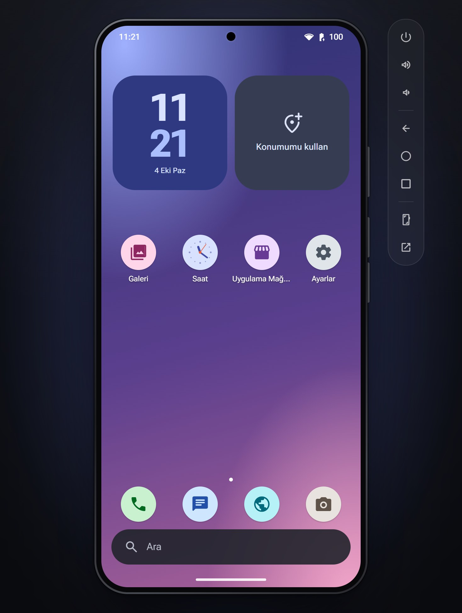

# WebDroid

<p align="center"></p>

[Türkçe](#türkçe) · [English](#english)

## Türkçe

Tarayıcıda çalışan bir Android telefonu. Görünüşünü ve hareketlerini Android 15'e olabildiğince yaklaştırdık, içindeki uygulamalar da çalışıyor: iki sekme açıp birbirinizi arayabilir, mesajlaşabilir, bilgisayarınızın kamerasıyla fotoğraf çekip galeride görebilirsiniz.

Kurmadan denemek için: https://mihrimatrix.github.io/android-react/. Bu sürümün sunucusu yok, veriler tarayıcınızda kalır. Arama ve mesaj yalnızca aynı tarayıcıdaki sekmeler arasında çalışır, Tarayıcı uygulaması da çoğu siteyi açamaz.

### Çalıştırmak

```bash
bun install
bun dev
```

Ardından http://localhost:4321 adresini açın. İlk açılışta dil, ad, ekran kilidi ve duvar kağıdı için kısa bir kurulum var.

### Bilmekte fayda var

- İkinci bir telefon için telefonun yanındaki araç çubuğunda en alttaki düğmeye basın ya da adrese `?device=bir-isim` ekleyin. Her cihazın kendi numarası olur.
- Klavye: `Esc` geri, `F7` güç, `F8` / `F9` ses, `F7` + `F8` ekran görüntüsü.
- Veriler sunucuda, `data/` klasöründeki SQLite dosyasında cihaz başına tutulur.
- Her uygulama `src/apps/` altında tek bir dosya. Yeni bir uygulama için mevcut birini (ör. `calculator.tsx`) örnek alıp `src/apps/index.ts`'e ekleyin. Uygulamalar birbirini import etmez, intent'lerle konuşur.
- Testler `bun test`, kurallar `bun run lint`.
- `bun run build:pages` sunucusuz sürümü `dist/` klasörüne derler. Orada `src/static/sw.ts` adlı Service Worker, sunucunun `/api` adreslerini IndexedDB ile yanıtlar. `main`'e yapılan her push bu sürümü GitHub Pages'e yayınlar.

Bun, React 19, TypeScript, Tailwind ve Zustand ile yazıldı. Harita OpenStreetMap, hava durumu Open-Meteo kullanıyor; ikisi de API anahtarı istemiyor.

## English

An Android phone that runs in your browser. We got its look and motion as close to Android 15 as we could, and its apps work: open two tabs and you can call each other, text, or take a photo with your computer's camera and find it in the gallery.

To try it without installing anything: https://mihrimatrix.github.io/android-react/. That version has no server, so your data stays in your browser. Calls and messages only reach other tabs in the same browser, and the Browser app can't open most sites.

### Running it

```bash
bun install
bun dev
```

Then open http://localhost:4321. The first launch walks you through language, name, screen lock and wallpaper.

### Good to know

- For a second phone, press the bottom button on the toolbar next to the phone, or add `?device=some-name` to the URL. Every device gets its own number.
- Keyboard: `Esc` back, `F7` power, `F8` / `F9` volume, `F7` + `F8` screenshot.
- Data lives on the server, one SQLite file in `data/`, kept per device.
- Each app is a single file in `src/apps/`. To add one, copy an existing app (say `calculator.tsx`) and register it in `src/apps/index.ts`. Apps never import each other; they talk through intents.
- Tests: `bun test`. Project rules: `bun run lint`.
- `bun run build:pages` builds the serverless version into `dist/`. There a service worker, `src/static/sw.ts`, answers the server's `/api` routes from IndexedDB. Every push to `main` publishes it to GitHub Pages.

Built with Bun, React 19, TypeScript, Tailwind and Zustand. Maps come from OpenStreetMap and weather from Open-Meteo. Neither needs an API key.
